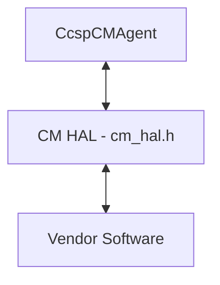
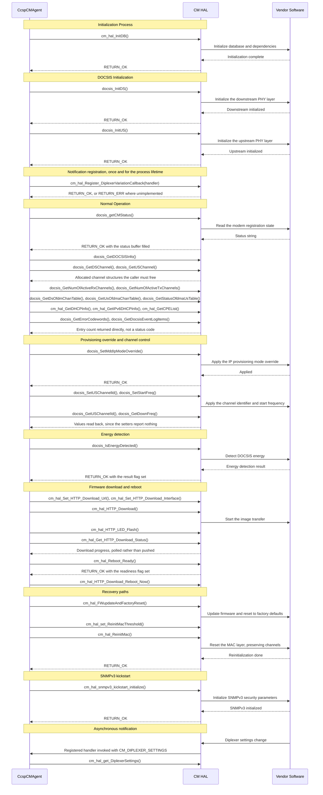
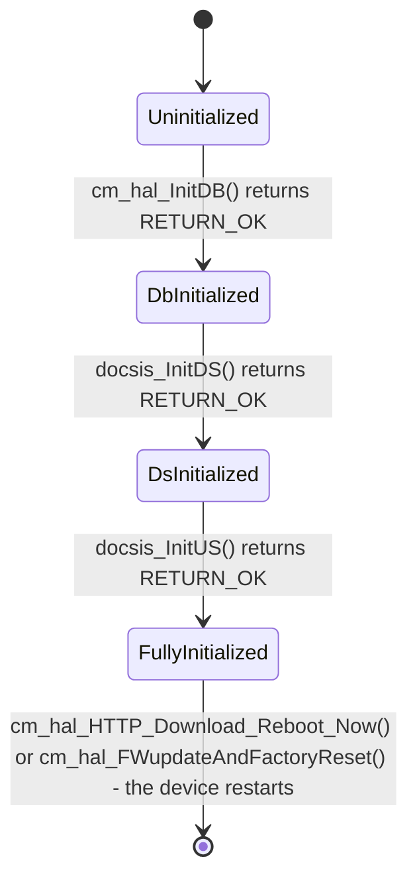

# CM HAL Documentation

## Version History

| Date | Comment | Version |
| --- | --- | --- |
| 2026-08-24 | First recorded revision of this document. Brought to the canonical `HAL` specification topic set: every declared `API` is named, the four version identities are separated, the asynchronous-notification and device-management claims are corrected against `include/cm_hal.h`, and the placeholder identifiers in the sequence diagram are replaced with declared ones. | 0.1.0 |

## Acronyms

The expansions below cover the terms this document uses.

- `ANSC` \- the legacy `RDK` type prefix carried by the `ANSC_IPV4_ADDRESS` macro
- `API` \- Application Programming Interface
- `BPI` \- Baseline Privacy Interface, the `DOCSIS` link-layer security protocol
- `CM` \- Cable Modem
- `CM HAL` \- Cable Modem Hardware Abstraction Layer, the interface this document specifies
- `CPE` \- Customer Premises Equipment
- `CPU` \- Central Processing Unit
- `DHCP` \- Dynamic Host Configuration Protocol
- `DOCSIS` \- Data Over Cable Service Interface Specification
- `DS` \- Downstream, the direction from the network toward the modem
- `DSOFDM` \- Downstream Orthogonal Frequency Division Multiplexing
- `HAL` \- Hardware Abstraction Layer
- `HTTP` \- Hypertext Transfer Protocol
- `IP` \- Internet Protocol
- `IPv4` \- Internet Protocol version 4
- `IPv6` \- Internet Protocol version 6
- `LED` \- Light Emitting Diode, the indicator the download path flashes
- `LLD` \- Low Latency DOCSIS
- `MAC` \- Media Access Control
- `MDD` \- MAC Domain Descriptor
- `OFDM` \- Orthogonal Frequency Division Multiplexing
- `OFDMA` \- Orthogonal Frequency Division Multiple Access
- `PHY` \- Physical layer
- `QoS` \- Quality of Service
- `RDK-B` \- Reference Design Kit for Broadband
- `RF` \- Radio Frequency
- `SNMP` \- Simple Network Management Protocol
- `SNR` \- Signal-to-Noise Ratio
- `TFTP` \- Trivial File Transfer Protocol
- `TLS` \- Transport Layer Security
- `ToD` \- Time of Day
- `URL` \- Uniform Resource Locator
- `US` \- Upstream, the direction from the modem toward the network
- `USOFDMA` \- Upstream Orthogonal Frequency Division Multiple Access
- `WAN` \- Wide Area Network

## Description

The CM HAL abstracts a `DOCSIS` cable modem so that `RDK-B` can drive it without depending on the modem chipset or on the `DOCSIS` generation it implements. This repository holds the interface definition only: a vendor supplies the implementation, and `CcspCMAgent`, the `RDK-B` middleware component that manages the cable modem, is the caller that consumes it through `cm_hal.h`.

The diagram below shows the software architecture of the CM HAL stack.

**What this interface declares:**

- **Initialization:** `cm_hal_InitDB()` brings up the HAL and its dependencies; `docsis_InitDS()` and `docsis_InitUS()` prepare the downstream and upstream `PHY` layers and direct hardware access.
- **Status and registration:** The modem's `DOCSIS` status as a formatted string, and the registration detail behind it: scanning, ranging, `TFTP` config-file download, data registration, `ToD` synchronisation, `BPI` state and network access.
- **Channel information and statistics:** Downstream and upstream channel parameters, active channel counts, error codeword counts, and the `DOCSIS 3.1` `DSOFDM` and `USOFDMA` channel and status tables.
- **Channel and frequency control:** The upstream channel identifier, the primary downstream start frequency and the `MDD` `IP` provisioning-mode override. With the `HTTP` download settings and the `MAC` re-initialisation threshold, these are the only values a caller writes through this interface.
- **Addressing information, read-only:** `DHCP` and `IPv6` `DHCP` information and the `CPE` list. Addressing is configured outside this interface.
- **Firmware download and recovery:** `HTTP` download configuration, initiation and status polling, `LED` flashing during a download, reboot readiness, reboot, firmware update with factory reset, and `MAC`-layer re-initialisation with its threshold.
- **Diagnostics and identity:** The `DOCSIS` event log, certificate file path and status, four reset counters, market region, `SNMP` v3 kickstart initialisation and `DOCSIS` energy detection.
- **Asynchronous notification:** One callback, for diplexer variation - see `Asynchronous Notification Model`.

A caller may stay at the level of "is the modem online" through `docsis_getCMStatus()`, or descend to per-channel `DOCSIS 3.1` statistics; `API Surface` indexes every function.

## Optional Components

The following components are optional and it is up to the vendor's discretion whether a platform provides them. The declarations exist on every platform; what varies is whether the implementation behind them does anything.

- **Diplexer configuration and its notification:** `cm_hal_get_DiplexerSettings()` reads the current upstream and downstream diplexer band edges, and `cm_hal_Register_DiplexerVariationCallback()` installs the handler that follows their changes. A vendor may ship the registration as a stub that returns `RETURN_ERR`, so a caller treats a failed registration as "this platform does not report diplexer variation" and continues without retrying.
- **Low Latency DOCSIS:** `docsis_LLDgetEnableStatus()` returns `DISABLE` both when `LLD` is disabled and when the entry is missing from the modem's bootfile, so a caller cannot tell the two apart.
- **DOCSIS 3.1 channel tables:** `docsis_GetDsOfdmChanTable()`, `docsis_GetUsOfdmaChanTable()` and `docsis_GetStatusOfdmaUsTable()` describe `DOCSIS 3.1` `OFDM` and `OFDMA` channels; a modem operating on an earlier `DOCSIS` generation has none to report. A caller reads the entry count these functions write and treats zero entries as "none present" rather than as a failure.

## Component Runtime Execution Requirements

This interface is delivered as a shared library that the caller links against, and its lifetime is that of the calling process. The requirements below bind the vendor implementation and are what a caller relies on.

### Initialization and Startup

During initialization and startup, the caller (`CcspCMAgent`) must invoke the following APIs in this order:

- `cm_hal_InitDB()` - initializes the HAL and the database connections and subsystems the rest of the interface relies on. It fails if it cannot create threads or open files.
- `docsis_InitDS()` - prepares the global `PHY`-level data structures and direct hardware access for the downstream (`DS`) direction.
- `docsis_InitUS()` - the same for the upstream (`US`) direction.

No other function may be called before `cm_hal_InitDB()` returns `RETURN_OK`. The caller is responsible for enforcing this order.

### Threading Model

The interface is not required to be thread safe.

Vendors can implement internal threading and event mechanisms for operational purposes. These mechanisms must ensure thread safety when interacting with the provided interface. Additionally, they must guarantee cleanup of resources upon closure.

A caller serialises its own calls into this interface. The diplexer variation handler serialises its access to caller state and must not assume that it runs on the registering thread.

### Process Model

This module is expected to be called from multiple processes.

The requirement is to ensure that the module can handle concurrent calls effectively. The vendor needs to implement proper synchronization and scalability measures for robust performance.

### Memory Model

The caller owns the memory it passes to this interface; five functions return memory that the caller must free.

#### Caller Responsibilities

- Allocate and free every buffer and structure passed to the module to populate.
- Zero-terminate every string passed to the module.
- Size each buffer to at least the minimum stated on its declaration; an undersized buffer can corrupt memory.
- Free the memory returned by `docsis_GetDSChannel()`, `docsis_GetUSChannel()`, `docsis_GetDsOfdmChanTable()`, `docsis_GetUsOfdmaChanTable()` and `docsis_GetStatusOfdmaUsTable()`. The three table functions report the array length through their entry-count argument.

#### Module Responsibilities

- Modules must allocate and de-allocate memory for their internal operations, and release all internally allocated memory upon closure.
- Modules allocate nothing on the caller's behalf unless the API documentation states otherwise, as it does for the five functions above.

### Power Management Requirements

The CM HAL does not participate in power management: it receives no power-state notifications and offers no power controls. `cm_hal_HTTP_Download_Reboot_Now()` and `cm_hal_FWupdateAndFactoryReset()` restart the device as recovery operations, described under `API Surface`.

### Asynchronous Notification Model

This interface has one asynchronous notification: the diplexer variation callback `cm_hal_DiplexerVariationCallback`, which the implementation invokes when the modem's diplexer band edges change. `cm_hal_Register_DiplexerVariationCallback()` installs it.

- **Registration is one-way:** The registered callback cannot be removed and should be provided during initialization, so the handler must remain valid for the lifetime of the process.
- **The handler receives the settings by value:** a `CM_DIPLEXER_SETTINGS` structure holding the upstream and downstream diplexer upper band edges in `MHz`.
- **The handler returns a status:** `RETURN_OK` on successful processing of the settings, `RETURN_ERR` on error.
- **Registration may fail:** `cm_hal_Register_DiplexerVariationCallback()` returns `RETURN_ERR` on a platform that does not implement the facility; `Optional Components` gives the caller's response.

The handler must not block: it records the new settings and returns, leaving any lengthy reaction to the caller's own thread. Registration state, channel changes and firmware download progress are polled; download progress through `cm_hal_Get_HTTP_Download_Status()`.

### Blocking calls

The APIs are synchronous and must complete within a time commensurate with the operation. They are called from a single thread context and therefore must not suspend, with one exception: `cm_hal_InitDB()` blocks while the hardware is not ready, so the caller performs initialization on a thread that nothing else waits on. Calls that wait on a response from a connected device time out in accordance with their API documentation.

- `docsis_ClearDocsisEventLog()` must not block or use blocking system calls; it starts the clearing asynchronously and returns.
- `cm_hal_HTTP_Download()` initiates a firmware download, and `cm_hal_Get_HTTP_Download_Status()` reports its progress.

### Internal Error Handling

`RETURN_OK` is `0` and `RETURN_ERR` is `-1`. A caller reads the return type before the return value, because three return shapes exist:

| Return shape | Declarations | What a caller does with it |
| --- | --- | --- |
| A status code | 45 of the 51 declarations, plus the callback | Treats only `RETURN_OK` as success and any other value as a failure, whose cause is in the vendor log; `docsis_LLDgetEnableStatus()` is the exception noted below the table. |
| A value, not a status | `docsis_GetUSChannelId()` returns the channel identifier, `docsis_GetDownFreq()` the frequency, `docsis_GetDocsisEventLogItems()` the number of log entries retrieved, and `cm_hal_Get_HTTP_Download_Status()` the download progress or error | Treats a zero count from `docsis_GetDocsisEventLogItems()` as a valid answer. Reads `cm_hal_Get_HTTP_Download_Status()` as `0` not started, `1` to `99` percent complete, `100` ready to reboot, and `400` to `407` or `500` failed. Validates the channel identifier and frequency against the modem's reported state, because neither carries an error indication. |
| Nothing at all | `docsis_SetUSChannelId()` and `docsis_SetStartFreq()` are declared `void` | Confirms the write by reading the value back with `docsis_GetUSChannelId()` or `docsis_GetDownFreq()`. |

`docsis_LLDgetEnableStatus()` returns `ENABLE`, `DISABLE` or `RETURN_ERR`; only `RETURN_ERR` indicates a failed read.

A caller moves on to the next initializer, or to any other call, only after the current initializer returns `RETURN_OK`; any other result from `cm_hal_InitDB()`, `docsis_InitDS()` or `docsis_InitUS()` leaves the HAL unusable for the rest of the process.

### Persistence Model

There is no requirement for the HAL to persist any setting information.

A caller that needs a value it wrote to survive a restart re-applies it after the restart. Provisioned values, such as the `LLD` bootfile entry, are persisted by the modem's provisioning system.

## Non functional requirements

The following non functional requirements should be supported by the component.

### Logging and debugging requirements

The component is required to record all errors and critical informative messages to aid in identifying, debugging, and understanding the functional flow of the system. Logging should be implemented using the syslog method, as it provides robust logging capabilities suited for system-level software. The use of `printf` is discouraged unless `syslog` is not available.

All HAL components must adhere to a consistent logging process. When logging is necessary, it should be performed into the `cm_vendor_hal.log` file, which is located in the `/rdklogs/logs/` directory.

Log levels follow the Linux standard logging system, in descending order of severity: `FATAL`, `ERROR`, `WARNING`, `NOTICE`, `INFO`, `DEBUG` and `TRACE`. Each log entry carries a timestamp, the log level and a message describing the event or condition.

Implementations must not log credentials, secrets, security-sensitive information, or other sensitive data. Where a failed call must be diagnosed, the log records the operation and its outcome, never the values passed to it.

### Memory and performance requirements

The component should keep its memory and `CPU` utilization during normal `CM` operations commensurate with the operation required.

### Quality Control

An implementation should pass analysis with third-party tools such as `Coverity`, `Black Duck` and `Valgrind` without reported issues. Neither the HAL implementation nor the vendor software beneath it may introduce memory leaks or memory corruption.

Any change to a file listed under `Source References` obliges a review of this document by the code owner listed in `.github/CODEOWNERS`.

### Licensing

The interface definition is licensed under the Apache License 2.0, with the full text in `LICENSE` and the attribution notice in `NOTICE`. An implementation of this interface is expected to be released under the Apache License 2.0.

### Build Requirements

The source code should be capable of, but not be limited to, building under the Yocto distribution environment. The recipe should deliver a shared library named as `libcm_mgnt.so`.

A caller of that library:

1. must include `cm_hal.h` to make use of CM HAL capabilities;
2. must include a linker dependency for `libcm_mgnt`.

### Variability Management

Changes to the interface are controlled by versioning. Vendors implement a designated version of the interface and move to later versions as their service agreements require. Each interface version follows [Semantic Versioning 2.0.0](https://semver.org/spec/v2.0.0.html), and vendor code complies with a specific version.

The interface version is identified by the repository's release tag.

### Platform or Product Customization

Every declaration in `cm_hal.h` is unconditional, so product variation is expressed at runtime and a caller reads it rather than compiling for it:

- `cm_hal_GetMarket()` reports the market region the modem is built for.
- `docsis_GetDOCSISInfo()` reports the `DOCSIS` version the modem implements, which decides whether the `DOCSIS 3.1` tables under `Optional Components` have anything to return.
- `cm_hal_get_DiplexerSettings()` reports the diplexer band edges, which differ between regional plant designs.
- `docsis_LLDgetEnableStatus()` reports whether the modem's bootfile provisions Low Latency DOCSIS.

A caller that must behave differently per product branches on these readings.

## Interface API Documentation

All HAL function prototypes and datatype definitions are available in the `cm_hal.h` file, grouped there as `CM_HAL_TYPES` for the data types and `CM_HAL_APIS` for the functions.

### Theory of operation and key concepts

#### Object Lifecycles

- **Creation/initialization:** The HAL is brought into use by the initialization sequence under `Initialization and Startup`.
- **Usage:** After initialization, the caller configures and queries modem parameters, reads downstream and upstream channel information, handles the diplexer notification and controls operational states.
- **Destruction/cleanup:** The interface has no de-initialization function, so it cannot be released and re-acquired within one process. Cleanup within the HAL happens when the application terminates, and the caller frees the allocations listed under `Caller Responsibilities`.

#### Method Sequencing

- **Initialization first:** the initialization order under `Initialization and Startup` precedes every other call.
- **Sequential dependency:** While most functions can be called independently once initialization is complete, some operations logically depend on the state of the modem or previous API calls (e.g., configuring channels before retrieving channel-specific data).
- **Event handling:** `cm_hal_Register_DiplexerVariationCallback()` is called during initialization, as `Asynchronous Notification Model` requires.
- **Configure-then-start for a download:** set the `URL` and filename with `cm_hal_Set_HTTP_Download_Url()`, optionally set the interface with `cm_hal_Set_HTTP_Download_Interface()`, initiate the download with `cm_hal_HTTP_Download()`, poll `cm_hal_Get_HTTP_Download_Status()`, and only then check `cm_hal_Reboot_Ready()` and reboot with `cm_hal_HTTP_Download_Reboot_Now()`.

#### State-Dependent Behavior

- **Implicit state model:** The CM HAL interface operates under several implicit states:
  - **Uninitialized:** Before any initialization function has been called.
  - **Initialized:** The system has been initialized but may not yet be fully operational or connected to network services.
  - **Operational:** The modem is fully operational, and all functionality is available.
- **Modem state is observed, not driven:** `docsis_getCMStatus()` and `docsis_GetDOCSISInfo()` report the modem's `DOCSIS` bring-up progress, tabulated under `State Diagram`, and a caller polls them for a change.

### Data Structures and Defines

A caller constructs or interprets the types below. All are in the `CM_HAL_TYPES` group of `cm_hal.h`, where each member is documented.

**Type aliases:** Each is wrapped in `#ifndef`, so a caller that already defines the name keeps its own definition.

| Alias | Underlying type |
| --- | --- |
| `CHAR` | `char` |
| `UCHAR` | `unsigned char` |
| `BOOLEAN` | `unsigned char` |
| `USHORT` | `unsigned short` |
| `UINT8` | `unsigned char` |
| `INT` | `int` |
| `UINT` | `unsigned int` |
| `LONG` | `long` |
| `ULONG` | `unsigned long` |

**Status and boolean constants:** `Internal Error Handling` gives the semantics.

| Constant | Value | Represents |
| --- | --- | --- |
| `RETURN_OK` | `0` | Success, returned by the status-returning declarations. |
| `RETURN_ERR` | `-1` | Failure. |
| `TRUE`, `FALSE` | `1`, `0` | The two values a `BOOLEAN` field or out-parameter carries. |
| `ENABLE`, `DISABLE` | `1`, `0` | The enablement result of `docsis_LLDgetEnableStatus`, which returns one of these or `RETURN_ERR`. |

**Bounds and the address type:** The constants a caller sizes buffers and tables against.

| Constant | Represents |
| --- | --- |
| `OFDM_PARAM_STR_MAX_LEN` | Maximum length of an `OFDM` parameter string, `64`. |
| `IPV4_ADDRESS_SIZE` | Octets in an `IPv4` address, `4`. |
| `ANSC_IPV4_ADDRESS` | A macro expanding to an anonymous union of a `4`-octet array in dotted-decimal order and a `32`-bit value in network byte order. It is the type of the upgrade-server address in `CMMGMT_CM_DOCSIS_INFO` and of the addresses in the `DHCP` information structures. |
| `EVM_MAX_EVENT_TEXT` | Maximum length of the event text in `CMMGMT_CM_EventLogEntry_t`, `255`. |
| `MAX_KICKSTART_ROWS` | Maximum number of rows in `snmpv3_kickstart_table_t`, `5`. |

**Structures:** Seventeen are declared.

| Structure | Represents |
| --- | --- |
| `CMMGMT_CM_DS_CHANNEL` | A downstream channel: identifier, frequency, power level, `SNR`, modulation, octet and error counts, and lock status. |
| `CMMGMT_CM_US_CHANNEL` | An upstream channel: identifier, frequency, transmit power, channel type, symbol rate, modulation and lock status. |
| `CMMGMT_CM_DOCSIS_INFO` | `DOCSIS`-related information for the modem: the registration progression tabulated under `State Diagram`, the config file name, attempt counters, `ToD` status, `BPI` state, network access, upgrade-server address, `CPE` allowance, upstream and downstream service-flow parameters including `QoS`, data rates and core version. |
| `CMMGMT_CM_ERROR_CODEWORDS` | Codeword error statistics: unerrored, correctable and uncorrectable counts. |
| `CMMGMT_CM_EventLogEntry_t` | One entry of the modem's event log: index, first and last timestamps, occurrence count, level, identifier and text. |
| `CMMGMT_DML_CM_LOG` | Configuration settings for modem logging. |
| `CMMGMT_DML_DOCSISLOG_FULL` | A single entry within a `DOCSIS` log. |
| `CMMGMT_CM_DHCP_INFO` | The modem's `DHCP` configuration. |
| `CMMGMT_CM_IPV6DHCP_INFO` | The modem's `IPv6` `DHCP` configuration. |
| `CMMGMT_DML_CPE_LIST` | A single `CPE` entry. |
| `DOCSIF31_CM_DS_OFDM_CHAN` | Parameters of a `DOCSIS 3.1` `OFDM` downstream channel. |
| `DOCSIF31_CM_US_OFDMA_CHAN` | Parameters of a `DOCSIS 3.1` `OFDMA` upstream channel. |
| `DOCSIF31_CMSTATUSOFDMA_US` | Status information for a `DOCSIS 3.1` `OFDMA` upstream channel, including its ranging state and whether the channel is muted. |
| `fixed_length_buffer_t` | A buffer of fixed length: a `USHORT` byte count and a pointer to the data. |
| `snmp_kickstart_row_t` | One row of an `SNMP` v3 kickstart configuration: a security name and a security number, each a `fixed_length_buffer_t`. |
| `snmpv3_kickstart_table_t` | An `SNMP` v3 kickstart configuration table: a row count and up to `MAX_KICKSTART_ROWS` row pointers. |
| `CM_DIPLEXER_SETTINGS` | Diplexer frequency settings: the upstream and downstream upper band edges in `MHz`. This is the structure the notification handler receives. |

Twelve of those structures also declare a pointer alias formed by prefixing `P` to the structure name - `PCMMGMT_CM_DS_CHANNEL`, `PCMMGMT_CM_US_CHANNEL`, `PCMMGMT_CM_DOCSIS_INFO`, `PCMMGMT_CM_ERROR_CODEWORDS`, `PCMMGMT_DML_CM_LOG`, `PCMMGMT_DML_DOCSISLOG_FULL`, `PCMMGMT_CM_DHCP_INFO`, `PCMMGMT_CM_IPV6DHCP_INFO`, `PCMMGMT_DML_CPE_LIST`, `PDOCSIF31_CM_DS_OFDM_CHAN`, `PDOCSIF31_CM_US_OFDMA_CHAN` and `PDOCSIF31_CMSTATUSOFDMA_US`. Several signatures in `API Surface` use those aliases; the header marks them for retirement, so new code prefers the structure name.

**The callback typedef:** `cm_hal_DiplexerVariationCallback` is the handler type that `cm_hal_Register_DiplexerVariationCallback` installs; `Asynchronous Notification Model` describes it.

### API Surface

All **51** functions in the `CM_HAL_APIS` group of `cm_hal.h` are listed below by functional area. Each declaration's Doxygen block in `cm_hal.h` carries the per-`API` detail: parameter direction and ranges, buffer ownership, pre-conditions and return values.

**Initialization \- 3 functions:** The sequence `Initialization and Startup` requires, in that order.

| API | Purpose |
| --- | --- |
| `cm_hal_InitDB` | Initializes the HAL and its dependencies. |
| `docsis_InitDS` | Initializes the downstream `PHY` layer and direct hardware access. |
| `docsis_InitUS` | Initializes the upstream `PHY` layer and direct hardware access. |

**Modem and DOCSIS status \- 2 functions:** The fast answer, and the detailed one behind it.

| API | Purpose |
| --- | --- |
| `docsis_getCMStatus` | Retrieves and formats the modem's `DOCSIS` status into a caller-supplied buffer of at least `40` bytes; the value set is enumerated under `State Diagram`. |
| `docsis_GetDOCSISInfo` | Retrieves the current `DOCSIS` registration status into a caller-allocated `CMMGMT_CM_DOCSIS_INFO` structure. |

**Channel information \- 5 functions:** Per-channel parameters and how many channels are in use.

| API | Purpose |
| --- | --- |
| `docsis_GetDSChannel` | Retrieves downstream channel information in a structure the HAL allocates and the caller frees. |
| `docsis_GetUsStatus` | Retrieves the status of one upstream channel, selected by index, into a caller-supplied structure. |
| `docsis_GetUSChannel` | Retrieves upstream channel information in a structure the HAL allocates and the caller frees. |
| `docsis_GetNumOfActiveTxChannels` | Reads how many upstream channels the current registration is using. |
| `docsis_GetNumOfActiveRxChannels` | Reads how many downstream channels the current registration is using. |

**DOCSIS 3.1 OFDM and OFDMA tables \- 3 functions:** Each allocates an array and reports its length; the caller frees it. `Optional Components` explains why the array may be empty.

| API | Purpose |
| --- | --- |
| `docsis_GetDsOfdmChanTable` | Retrieves the `DSOFDM` channel table as an allocated array of `DOCSIF31_CM_DS_OFDM_CHAN` entries. |
| `docsis_GetUsOfdmaChanTable` | Retrieves the `USOFDMA` channel table as an allocated array of `DOCSIF31_CM_US_OFDMA_CHAN` entries. |
| `docsis_GetStatusOfdmaUsTable` | Retrieves the `USOFDMA` channel status table as an allocated array of `DOCSIF31_CMSTATUSOFDMA_US` entries. |

**Channel and frequency control \- 4 functions:** The two setters report nothing and the two getters return a bare value; `Internal Error Handling` describes how a caller handles both.

| API | Purpose |
| --- | --- |
| `docsis_GetUSChannelId` | Returns the upstream channel identifier within its `MAC` domain as a `UINT8` value, not a status code. |
| `docsis_SetUSChannelId` | Sets the upstream channel identifier within its `MAC` domain. Declared `void`. |
| `docsis_GetDownFreq` | Returns the current primary downstream channel frequency as a `ULONG` value, not a status code. |
| `docsis_SetStartFreq` | Sets the primary downstream channel frequency. Declared `void`. |

**Provisioning, MDD override and certificates \- 5 functions:** How the modem is provisioned with an `IP` mode, and the state of its certificate.

| API | Purpose |
| --- | --- |
| `docsis_GetMddIpModeOverride` | Reads the current `IP` provisioning-mode override status. |
| `docsis_SetMddIpModeOverride` | Sets the `IP` provisioning-mode override status. |
| `docsis_GetProvIpType` | Reads the provisioned `IP` type for the `WAN` interface. |
| `docsis_GetCert` | Reads the file path of the modem certificate. |
| `docsis_GetCertStatus` | Reads the modem certificate status. |

**Diagnostics: error codewords and event log \- 3 functions:**

| API | Purpose |
| --- | --- |
| `docsis_GetErrorCodewords` | Scans the active downstream channels and reports packet errors into a caller-allocated structure. |
| `docsis_GetDocsisEventLogItems` | Fills a caller-supplied array with up to a given number of event-log entries and **returns the number of entries retrieved**, not a status code. |
| `docsis_ClearDocsisEventLog` | Clears the event log asynchronously. |

**DHCP, CPE and market information \- 4 functions:** All read-only.

| API | Purpose |
| --- | --- |
| `cm_hal_GetDHCPInfo` | Reads the modem's `DHCP` information into a structure the caller allocates and frees. |
| `cm_hal_GetIPv6DHCPInfo` | Reads the modem's `IPv6` `DHCP` information into a structure the caller allocates and frees. |
| `cm_hal_GetCPEList` | Reads the list of connected `CPE` devices and their count; the caller allocates and frees both the list and the mode string, which is `router` or `bridge` and at most `100` bytes. |
| `cm_hal_GetMarket` | Reads the modem's market region, for example `EURO` for Europe or `US` for the United States. |

**HTTP firmware download \- 8 functions:** A configure-then-start-then-poll sequence, as `Method Sequencing` describes.

| API | Purpose |
| --- | --- |
| `cm_hal_Set_HTTP_Download_Url` | Configures the download `URL` and image filename. Both buffers must be at least `200` bytes. |
| `cm_hal_Get_HTTP_Download_Url` | Reads back the configured download `URL` and filename, under the same buffer requirement. |
| `cm_hal_Set_HTTP_Download_Interface` | Selects the interface the download is to use. |
| `cm_hal_Get_HTTP_Download_Interface` | Reads back the interface the download is configured to use. |
| `cm_hal_HTTP_Download` | Initiates the download. |
| `cm_hal_Get_HTTP_Download_Status` | Reads the current download status; this is the interface's progress mechanism, in place of a notification. |
| `cm_hal_HTTP_Download_Reboot_Now` | Initiates a reboot, performing pre-reboot checks and updates. |
| `cm_hal_HTTP_LED_Flash` | Controls flashing of the `HTTP` `LED` indicator. |

**Firmware download safety:** `cm_hal_Set_HTTP_Download_Url` records, and `cm_hal_FWupdateAndFactoryReset` takes directly, the location of a firmware image that the device then runs. The interface validates neither argument, so the obligations fall on the caller and the vendor implementation:

- **The caller:** passes only an `https` `URL` on an operator-controlled host taken from the device's provisioned configuration, matched against an allowlist of scheme, host and port after normalization. It rejects userinfo, control characters and line breaks, treats the image name as a file name by rejecting path separators and `..` segments in literal or encoded form, and keeps both values within `200` bytes including the terminator.
- **The vendor implementation:** re-applies those checks and returns `RETURN_ERR` for a value that fails them. It fetches over `TLS` with certificate-chain and host-name verification, refuses a redirect that downgrades the scheme or leaves the allowlisted origin, and verifies the image signature against a key the device trusts before writing, unpacking or executing it. `cm_hal_Get_HTTP_Download_Status` reports a failed protection check as `403` to `407`.

`cm_hal_FWupdateAndFactoryReset` restarts the device and discards its configuration, so the caller validates the location before the call.

**Reboot, factory reset and MAC re-initialization \- 5 functions:** The recovery operations, and the threshold that governs the automatic one. `cm_hal_FWupdateAndFactoryReset` is bound by the firmware download safety requirements above.

| API | Purpose |
| --- | --- |
| `cm_hal_Reboot_Ready` | Reports whether the system is ready for a reboot. |
| `cm_hal_FWupdateAndFactoryReset` | Initiates a firmware update from a given `URL` and image name, followed by a factory reset. |
| `cm_hal_ReinitMac` | Resets the modem's `MAC` layer while preserving its channels. |
| `cm_hal_set_ReinitMacThreshold` | Sets the threshold at which `MAC`-layer re-initialization is triggered. |
| `cm_hal_get_ReinitMacThreshold` | Reads the `MAC`-layer re-initialization threshold. |

**Reset counters \- 4 functions:** Four separately maintained, read-only counters.

| API | Purpose |
| --- | --- |
| `cm_hal_Get_CableModemResetCount` | Reads how many times the modem has been reset. |
| `cm_hal_Get_LocalResetCount` | Reads how many of those resets were local. |
| `cm_hal_Get_DocsisResetCount` | Reads how many were `DOCSIS`-related. |
| `cm_hal_Get_ErouterResetCount` | Reads how many times the eRouter has been reset. |

**Security, energy detection and diplexer \- 5 functions:** Includes the interface's only notification registration.

| API | Purpose |
| --- | --- |
| `cm_hal_snmpv3_kickstart_initialize` | Initializes `SNMP` v3 security parameters from a kickstart table. |
| `docsis_IsEnergyDetected` | Reports whether `DOCSIS` energy is present, which is how a caller decides whether the `WAN` is connected. |
| `docsis_LLDgetEnableStatus` | Reports whether Low Latency `DOCSIS` is enabled, returning `ENABLE`, `DISABLE` or `RETURN_ERR`. |
| `cm_hal_get_DiplexerSettings` | Reads the current diplexer band-edge settings. |
| `cm_hal_Register_DiplexerVariationCallback` | Registers the handler invoked when the diplexer settings change. |

### Sequence Diagram

The exchange below shows `CcspCMAgent` driving the CM HAL through initialization, normal operation, configuration, firmware download and recovery, and receiving the diplexer notification.

The remaining functions - the certificate, provisioning-type, market, reset-counter and configuration read-backs, `docsis_GetUsStatus`, `docsis_ClearDocsisEventLog` and `docsis_LLDgetEnableStatus` - are called as needed rather than in sequence, and are listed under `API Surface`.

### State Diagram

Two state vocabularies apply. The HAL lifecycle is established by the pre-conditions and post-conditions of the three initializers and is drawn below. The modem's `DOCSIS` status is a set of reported values, not a state machine, so it is tabulated rather than drawn with transitions.

**The HAL lifecycle:** The diagram follows the initialization order under `Initialization and Startup`; every function is callable once `docsis_InitUS` returns `RETURN_OK`.

There is no edge back to `Uninitialized` within one process, as `Object Lifecycles` explains. `Internal Error Handling` states the caller's response to a failed initializer. Both terminal calls restart the device, so a caller must not rely on any code after them executing.

`cm_hal_ReinitMac` resets the modem's `MAC` layer while preserving the downstream and upstream channels; it does not change the HAL lifecycle state. Afterwards a caller polls `docsis_getCMStatus` until the modem reports the state it needs.

**The modem's `DOCSIS` status:** `docsis_getCMStatus` reports one of the twenty-four zero-terminated strings below. A caller compares the buffer against these spellings exactly, tolerates a value it does not recognise, and takes the definition of each phase from the `DOCSIS` specification the modem implements; the third column states only what each spelling names.

| Value | Group | What its spelling names |
| --- | --- | --- |
| `NOT_READY` | Bring-up | The modem is not yet ready. |
| `NOT_SYNCHRONIZED` | Bring-up | Downstream synchronisation has not been achieved. |
| `PHY_SYNCHRONIZED` | Bring-up | `PHY`-level synchronisation has been achieved. |
| `US_PARAMETERS_ACQUIRED` | Bring-up | The upstream parameters have been acquired. |
| `RANGING_COMPLETE` | Bring-up | Ranging has completed. |
| `DHCPV4_COMPLETE` | Bring-up | `DHCPv4` address acquisition has completed. |
| `DHCPV6_COMPLETE` | Bring-up | `DHCPv6` address acquisition has completed. Which of the two a modem reports depends on its provisioning mode, which `docsis_GetProvIpType` reads. |
| `TOD_ESTABLISHED` | Bring-up | Time of day has been established. |
| `SECURITY_ESTABLISHED` | Bring-up | Link-layer security has been established. |
| `CONFIG_FILE_DOWNLOAD_COMPLETE` | Bring-up | The configuration file has been downloaded. |
| `REGISTRATION_COMPLETE` | Bring-up | Registration has completed. |
| `OPERATIONAL` | Bring-up | The modem is operational. |
| `RANGING_IN_PROGRESS`, `DHCPV4_IN_PROGRESS`, `DHCPV6_IN_PROGRESS`, `REGISTRATION_IN_PROGRESS`, `EAE_IN_PROGRESS`, `DS_TOPOLOGY_RESOLUTION_IN_PROGRESS` | In progress | The named phase is under way rather than complete. |
| `BPI_INIT` | In progress | Baseline privacy initialization. |
| `ACCESS_DENIED` | Condition | Access was denied. |
| `FORWARDING_DISABLED` | Condition | Forwarding is disabled. |
| `RF_MUTE_ALL` | Condition | All `RF` transmission is muted. |
| `OTHER` | Not mapped | A state the implementation reports as none of the above. |
| `Unsupported status` | Not mapped | What an implementation reports for a state it cannot map onto the others. |

A caller relies on the buffer holding one value at a time. It must not treat a value as reachable only from a particular predecessor, and must not assume it observes every value, because successive reads may skip one or several. On failure `docsis_getCMStatus` leaves the buffer's contents undefined and the modem's status unknown rather than `NOT_READY`.

`docsis_GetDOCSISInfo` reports the same progress field by field in `CMMGMT_CM_DOCSIS_INFO`. Its values correspond to the status values above by phase name only.

| Field | Values it takes | Reports |
| --- | --- | --- |
| `DOCSISDownstreamScanning`, `DOCSISDownstreamRanging`, `DOCSISUpstreamScanning`, `DOCSISUpstreamRanging` | `NotStarted`, `InProgress`, `Complete` | Each of the four `PHY`-level bring-up phases, downstream then upstream. |
| `DOCSISTftpStatus` | `NotStarted`, `InProgress`, `DownloadComplete` | The configuration-file download; the file name lands in `DOCSISConfigFileName`. |
| `DOCSISDataRegComplete` | `InProgress`, `RegistrationComplete` | Data registration, the last phase named before the modem is operational. |
| `ToDStatus` | `NotStarted`, `Complete` | Time-of-day synchronisation. |
| `DOCSISDHCPAttempts`, `DOCSISTftpAttempts` | A count | How many attempts address acquisition and configuration download have taken. |

`BPIState` and `NetworkAccess` are `BOOLEAN` flags, not phases: they report whether link-layer privacy is established and whether network access is permitted, and a caller reads them alongside the status value.

## Source References

- [rdkcentral/rdkb-halif-cm/include/cm_hal.h](https://github.com/rdkcentral/rdkb-halif-cm/blob/develop/include/cm_hal.h) — the interface: function declarations, data types, constants and per-`API` Doxygen documentation
- [rdkcentral/rdkb-halif-cm/CHANGELOG.md](https://github.com/rdkcentral/rdkb-halif-cm/blob/develop/CHANGELOG.md) — tagged releases of the interface
- [rdkcentral/rdkb-halif-cm/.github/CODEOWNERS](https://github.com/rdkcentral/rdkb-halif-cm/blob/develop/.github/CODEOWNERS) — repository owner and reviewer
- [rdkcentral/rdkb-halif-cm/LICENSE](https://github.com/rdkcentral/rdkb-halif-cm/blob/develop/LICENSE) — Apache License 2.0 text
- [rdkcentral/rdkb-halif-cm/NOTICE](https://github.com/rdkcentral/rdkb-halif-cm/blob/develop/NOTICE) — attribution notice
- [rdkcentral/rdkb-halif-cm/COPYING](https://github.com/rdkcentral/rdkb-halif-cm/blob/develop/COPYING) — Apache License 2.0 text, a symbolic link to `LICENSE`
